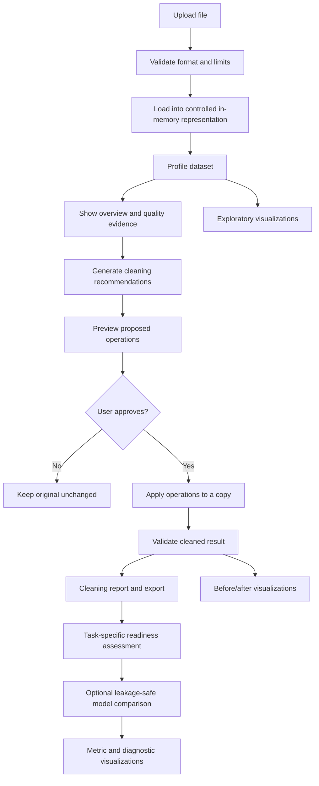

# NUMPA Engine Logic & Integration Guide

> **Purpose:** Explain how NUMPA should inspect, clean, visualize, assess, and compare machine-learning algorithms; why each decision exists; and how the pieces should be integrated without creating data leakage or misleading users.
>
> **Audience:** NUMPA founder, developers, Codex/Claude, contributors, and anyone extending the product.
>
> **Status labels used in this document**
> - **Current repository contract** — behaviour or design rules documented in the repository's current README/specifications.
> - **Recommended implementation** — engineering guidance for a robust implementation; verify against code and tests before claiming it is live.
> - **Not yet confirmed** — details that must be checked in the actual engine source before being described as implemented.

---

## 1. NUMPA's product philosophy

NUMPA should help a user move from a raw dataset to a better-understood, safer-to-use dataset and a more informed modelling decision.

The central workflow is:

1. Upload a dataset.
2. Inspect its structure and quality.
3. Explain the issues found.
4. Recommend cleaning operations with evidence and reasons.
5. Let the user preview and approve changes.
6. Apply approved changes to a separate copy.
7. Validate and report what changed.
8. Recalculate ML readiness for a selected task.
9. Optionally compare suitable baseline algorithms.
10. Visualize the data and results so the user can understand them.
11. Export the cleaned data and reports.

**Core principle:** NUMPA must not silently change user data, invent domain rules, hide uncertainty, or present a heuristic score as a promise of model performance.

### Important distinction

- Data quality describes properties of the dataset.
- ML readiness estimates whether the dataset appears prepared for a selected modelling task.
- Model evaluation measures how candidate models perform under a defined validation strategy.
- Visualization communicates evidence; it does not prove causation or guarantee correctness.

These are connected, but they are not interchangeable.

---

## 2. Recommended system architecture

Keep the business logic in independent, testable engine modules. API routes should validate requests, call engines, and format responses; they should not contain the core algorithms.

Suggested logical boundaries (adapt names to the repository's actual layout):

```text
apps/
  api/
    app/
      routes/
        datasets.py
        cleaning.py
        readiness.py
        visualization.py
        model_comparison.py
      engines/
        ingestion/
        profiling/
        cleaning/
        visualization/
        readiness/
        evaluation/
      schemas/
      tests/
docs/
  ENGINE_LOGIC_AND_INTEGRATION_GUIDE.md
```

The folder names above are a **recommended organization**, not a claim that every folder currently exists.

### Why separate engines from routes?

- The same engine can be called from the web app, desktop app, API, background worker, or future integrations.
- Unit tests can exercise logic without starting a web server.
- A route can change without rewriting the cleaning or scoring algorithm.
- The system can later add queues or workers only when measured workload justifies them.

### Data flow



---

## 3. Dataset ingestion and profiling

### 3.1 Validate before analysis

**Current repository contract:** the initial loader is documented as supporting tabular CSV, XLSX, JSON, Parquet, Arrow IPC, and Feather. The README explicitly says that folder datasets, WebDataset archives, raw text corpora, and specialized optimized-Parquet variations need separate loaders and are not part of the current supported claim.

The API README documents operational limits of 50 MB, 1,000,000 rows, and 2,000 columns. Confirm the live deployment configuration before changing or advertising limits.

Recommended checks:

- File extension and actual file signature/content consistency.
- File size, row count, column count, and decompression limits.
- Empty or malformed files.
- Duplicate column names.
- Unsupported nested or mixed structures.
- Safe parsing errors with actionable messages.
- Resource/time limits to reduce denial-of-service risk.

Do not trust a filename extension as proof of file format.

### 3.2 Build a reusable dataset profile

The profile should capture, where applicable:

| Profile signal | What it tells the user | Why it matters |
|---|---|---|
| Rows and columns | Dataset dimensions | Helps judge sample size and scale |
| Column names and types | Schema | Incorrect types can break analysis or modelling |
| Missing count and percentage | Missingness per column | Missingness can reduce usable information |
| Exact duplicate rows | Repeated records | May distort counts or model evaluation |
| Unique values / cardinality | Number of distinct values | Helps identify categorical, identifier-like, or high-cardinality fields |
| Numeric summaries | Mean, standard deviation, quantiles, range | Reveals scale, skew, and unusual values |
| Category frequencies | Common and rare labels | Reveals imbalance and inconsistent categories |
| Datetime parse and range | Time coverage and parse failures | Important for time-based analysis and forecasting |
| Constant / near-constant columns | Little or no variation | Such features may provide little predictive information |
| Candidate identifiers | Possible IDs or keys | IDs can cause leakage or meaningless relationships |

A profile is evidence, not a cleaning command. For example, a high-cardinality column may be a valid product code, a customer ID, or a useful text feature. Do not delete it based only on cardinality.

### 3.3 Profiling output contract

Return structured values rather than UI-ready sentences only. Include:

- Dataset identifier/request scope (without exposing private file contents).
- Schema and per-column statistics.
- Warnings and parse failures.
- Profile version.
- Sampling method and sample size if any metric is estimated.
- Limits or unsupported features encountered.

For large datasets, exact statistics may be expensive. If sampling is used, say so and make the sample reproducible.

---

## 4. Smart data-cleaning logic

### 4.1 The required lifecycle

**Current repository contract:** the cleaning engine follows:

**Detect → Recommend → Explain → Preview → Apply with approval → Validate → Report**

The original upload is immutable. Cleaning produces a new result and an audit record.

This is important because a cleaning operation can destroy information. A user must be able to understand and reverse the decision by returning to the original.

### 4.2 Recommendation object

Each recommendation should contain:

| Field | Example meaning |
|---|---|
| `rule_id` and `rule_version` | Stable identifier for the logic used |
| `issue_type` | Missing values, exact duplicates, parse failure, etc. |
| `columns` / affected rows | Where the issue was detected |
| `evidence` | Counts, percentages, sample examples, bounds |
| `proposed_action` | The exact operation being suggested |
| `parameters` | Median, mode, trim whitespace, etc. |
| `reason` | Plain-language explanation |
| `assumptions` | What NUMPA is assuming |
| `risk_level` | Low, medium, or high |
| `requires_approval` | Whether explicit user approval is mandatory |
| `estimated_impact` | Expected rows/cells/columns affected |
| `reversible` | Whether the operation can be reversed from the audit record |
| `validation_checks` | What must be checked after execution |

Do not show a recommendation as a vague instruction such as “fix data.” Show the observed issue and the proposed change separately.

### 4.3 Missing-value handling

First classify the column: numeric, categorical, datetime, text-like, identifier-like, or unknown. Then measure missing count and percentage and inspect the non-missing distribution.

| Candidate action | When it may be reasonable | Why / risk |
|---|---|---|
| Leave missing values | Missingness itself may carry information, or the model supports it | Avoids inventing values |
| Median imputation | Numeric column with skew/outliers where median is defensible | More robust to extreme values than mean |
| Mean imputation | Numeric column with a reasonably symmetric distribution and meaningful mean | Simple, but sensitive to outliers |
| Mode imputation | Categorical column where the most frequent category is a defensible replacement | Can over-represent the dominant class |
| Constant / explicit “Unknown” | A domain-approved missing category makes sense | Changes semantics; must be disclosed |
| Drop rows | Small, justified number of rows and deletion is acceptable | Can bias the sample if missingness is systematic |
| Drop column | Column is unusable and owner approves | May remove important signal |

**Do not automatically choose mean for every numeric column or mode for every categorical column.** A missingness mechanism (MCAR/MAR/MNAR) cannot reliably be inferred from a simple percentage alone. NUMPA should state uncertainty and ask for domain context when needed.

Entirely empty columns should not receive invented values. Recommend review or removal, with explicit approval.

### 4.4 Duplicates

Distinguish:

- **Exact duplicate rows:** every compared field matches.
- **Possible/business duplicates:** records share a key or appear similar but differ in one or more fields.

Exact duplicates can be counted and previewed. Removal still requires approval because repeated rows may represent legitimate repeated events.

Possible duplicates require a user-defined key or matching policy. Never silently merge records based on fuzzy similarity.

### 4.5 Type parsing and conversion

Examples: text to numeric, text to date, or mixed values to a consistent type.

Before conversion:

1. Detect parseable and unparseable values.
2. Preview representative failures.
3. Check decimal separators, thousands separators, locale and timezone ambiguity.
4. Detect possible precision loss.
5. Report values that would become null or change meaning.

Do not silently coerce failed values to null. Do not guess ambiguous dates such as 03/04/2025 without a selected locale or explicit confirmation.

### 4.6 Outliers and invalid values

Outlier detection should flag unusual observations, not automatically delete them.

Possible statistical signals include IQR fences and z-scores, but neither is a universal definition of an error:

- IQR fences: useful for flagging values far from the middle 50% of a distribution.
- Z-score: useful when distributional assumptions are reasonable; sensitive to skew and extreme values.
- Robust alternatives: median absolute deviation (MAD) can be more resistant to extreme observations.

NUMPA should show the threshold, number of affected records, and example values. Capping, winsorizing, or deleting outliers must be an explicit decision.

Invalid-value rules should come from user-provided or documented domain constraints (for example, age cannot be negative in a particular business context). Avoid inventing universal bounds.

### 4.7 Text and category normalization

Safe, previewable options can include trimming leading/trailing whitespace. More destructive changes need careful handling:

- Do not automatically merge “NY”, “New York”, and “New York City”.
- Do not case-fold identifiers, codes, passwords, or case-sensitive values.
- Do not remove punctuation from every text field.
- Do not translate, infer, or rewrite labels without a user-defined mapping.

Offer a before/after value mapping and collision count.

### 4.8 Operations that belong inside model pipelines

Scaling, encoding, imputation for model training, feature selection, and similar learned transformations should usually be fitted inside a leakage-safe ML pipeline, not permanently written into the user's raw cleaned dataset.

Why? If a scaler or imputer learns from the full dataset before the train/test split, information from the test set influences training. That makes evaluation optimistic.

Keep two concepts separate:

- **Dataset cleaning:** user-approved, inspectable changes to the dataset copy.
- **Model preprocessing:** transformations learned only from the training fold and applied to validation/test data using the fitted training transformation.

### 4.9 Post-clean validation

After applying changes, calculate before/after comparisons:

- Row and column counts.
- Data types and schema changes.
- Missing-cell counts and percentages.
- Exact duplicate count.
- Parse failures.
- Category cardinality and unexpected values.
- Numeric distributions and quantiles.
- Number of rows/cells changed or removed.
- Target column preservation.
- Warnings for unexpectedly large changes.

A validation failure should stop export or mark the output as requiring review. Do not report success merely because code execution did not throw an exception.

### 4.10 Reproducibility and audit

Store the operation order, rule versions, parameters, approval state, and before/after summaries. Deterministic operations should produce the same result for the same input, version, and parameters.

Never store raw data in logs. Avoid logging personal or sensitive cell values; use counts, safe examples, or redacted samples.

---

## 5. Visualization logic

### 5.1 What visualization should accomplish

NUMPA visualizations should answer a question, not merely decorate a dashboard.

Every chart should include:

- A clear title that states what is being shown.
- Axis labels and units where applicable.
- The population or sample used.
- Missing/filtered values treatment.
- A useful legend only when needed.
- A short interpretation or caveat.
- An accessible table or textual equivalent for key values.

Do not imply correlation is causation. Do not use a chart type that hides the distribution or misrepresents the scale.

### 5.2 Dataset exploration chart catalogue

| Chart | Use it when | Reason | Important caution |
|---|---|---|---|
| Histogram | One numeric variable | Shows distribution, skew, and possible multiple peaks | Bin width changes appearance |
| Box plot | Compare numeric distributions across groups | Shows median, quartiles, and flagged extremes | Whiskers/outlier markers are convention-dependent |
| Bar chart | Counts or aggregates for categories | Makes category comparisons clear | Sort and group rare categories carefully |
| Line chart | Values observed over ordered time or sequence | Reveals trend and seasonality | Sort time correctly; don't connect unrelated categories |
| Scatter plot | Relationship between two numeric variables | Reveals association, clusters, and nonlinear patterns | Overplotting can hide density |
| Correlation heatmap | Numeric pairwise association overview | Quickly reveals strong linear associations | Correlation is not causation; missing-data method matters |
| Missingness bar / matrix | Missing values by column or row | Shows where incompleteness is concentrated | A missingness pattern is not proof of its cause |
| Category frequency plot | Categorical distribution | Reveals rare labels and imbalance | High-cardinality columns may need top-N plus “other” |
| Pair plot / small multiples | A small number of numeric features | Shows pairwise patterns | Can become unreadable and expensive at scale |

### 5.3 Chart selection rules

Recommended deterministic selection:

1. Use detected semantic type, not only raw storage dtype.
2. If a numeric column has too many unique values, treat it as continuous unless the user marks it categorical.
3. If a category has many distinct values, show top-N and a clearly labelled remainder rather than rendering hundreds of bars.
4. For time-series charts, parse and sort timestamps and display gaps; never treat dates as unordered category labels.
5. For scatter plots on large data, use deterministic sampling or density aggregation and disclose it.
6. Correlation should specify method (Pearson, Spearman, or another supported method), pairwise sample count, and missing-value policy.
7. Do not calculate correlations on identifier-like columns by default.
8. Avoid misleading dual axes and truncated axes; if an axis is truncated, make it explicit.
9. Provide chart data and metadata separately from rendering code so the frontend can use a chart library without owning analytical logic.

### 5.4 Before/after visualizations

For cleaning comparisons, use the same chart configuration and comparable scales before and after whenever possible. Otherwise a change in axis range or binning can create a false impression of improvement.

Show:

- Before and after missingness.
- Before and after row count and duplicate count.
- Distribution overlays or side-by-side plots for changed numeric columns.
- Category counts for changed categorical columns.
- A list of exactly which columns were affected.

Do not label a dataset “better” solely because missingness or outlier count decreased. A cleaning action can reduce missingness while introducing bias.

### 5.5 Visualization response contract

A chart specification should include:

- `chart_type`
- `title`, `x_label`, `y_label`
- selected columns and aggregation
- series/categories
- data points or a bounded sample
- filters and null policy
- sample metadata
- calculation method (for example correlation method)
- warnings and interpretation hints

Keep rendering separate from calculation. The API should return validated chart-ready data; the web app should render it.

---

## 6. ML readiness assessment logic

### 6.1 What the score means

**Current repository contract:** readiness is a deterministic, explainable heuristic. It is not a prediction of accuracy, profitability, business value, or production success.

The task matters. A dataset can be suitable for one task and unsuitable for another.

### 6.2 Inputs

A sound assessment should use:

- Dataset schema and quality profile.
- Selected task: classification, regression, forecasting, or clustering.
- Target column for supervised tasks.
- Intended algorithm, if known.
- Validation strategy.
- Domain constraints.
- Versioned assessment configuration.

The repository specification lists candidate dimensions to validate through research; it explicitly does not define one final universal formula.

### 6.3 Candidate dimensions by task

| Dimension | Classification | Regression | Forecasting | Clustering |
|---|---:|---:|---:|---:|
| Missingness / type validity | Yes | Yes | Yes | Yes |
| Target completeness | Yes | Yes | Target/time series completeness | Not applicable in the same way |
| Target variation | Class count / rare classes | Target variance and distribution | Signal variation | Not a supervised target |
| Class imbalance | Yes | No | Sometimes for event labels | Not directly |
| Sample size | Class-aware | Yes | History length and horizon | Cluster stability / sample size |
| Timestamp continuity and gaps | If time-based | If time-based | Essential | If time-derived |
| Identifier-like features | Check | Check | Check | Check |
| Leakage risk | Yes | Yes | Especially temporal leakage | Leakage concept differs |
| Feature redundancy / scale | Task and model dependent | Task and model dependent | Lags and exogenous features | Distance metric and scaling critical |
| Algorithm prerequisites | Yes | Yes | Yes | Yes |

Do not force every dimension into every task. If evidence is unavailable or a dimension is not applicable, return “not assessed” or “not applicable,” not a fabricated zero.

### 6.4 Scoring design

A recommended design is a versioned set of dimension scores and weights. For example:

`readiness = weighted_aggregate(assessed_dimension_scores, configured_weights)`

This is a conceptual description, not the repository's confirmed formula. Do not invent or hard-code weights from this document.

Requirements:

- Deterministic code computes the score.
- AI can explain evidence or suggest checks, but cannot silently change score, weights, or thresholds.
- Every dimension returns evidence, score, weight, rationale, and caveat.
- Configuration validates allowed dimensions and normalizes weights according to a documented rule.
- Formula and configuration versions are returned and saved with the assessment.
- Insufficient evidence is visible.
- Task-specific thresholds must be justified and tested.
- Avoid false precision; display score bands and explanations when exact decimal precision is not meaningful.

### 6.5 Example explanation

A good result should say:

> “Target completeness is low because 18% of target values are missing. The current classification assessment lowers this dimension because supervised training requires known labels for the selected evaluation setup. Review whether those rows should be excluded or whether labels can be recovered.”

A poor result says:

> “Your dataset is 82% ready.”

The second statement has no evidence, no task context, and no actionable reason.

---

## 7. Comparing ML algorithms

### 7.1 What algorithm comparison is for

Algorithm comparison helps answer:

- Which candidate performs better on this dataset under this validation setup?
- Which metric matters for this problem?
- How stable are results across folds or repeated runs?
- What trade-offs exist between predictive performance, training time, inference time, and interpretability?

It does **not** establish that a model will perform equally well in production.

**Current repository README:** baseline classification and regression comparison is documented. It describes a reproducible 80/20 holdout and fitting preprocessing inside scikit-learn pipelines. Forecasting needs chronological validation and is explicitly not included in the current model-comparison claim. The README also describes model comparison as an optional/internal endpoint, not a primary customer-facing MVP feature.

**Not yet confirmed from this review:** the exact list of estimators currently implemented, their hyperparameters, and their metric definitions. Inspect the evaluation engine and tests before documenting exact model names as live.

### 7.2 Correct evaluation workflow

1. Validate task and target.
2. Separate target from feature columns.
3. Detect invalid target values and leakage risks.
4. Choose a validation strategy suitable for the data.
5. Split data before fitting learned preprocessing.
6. Build one independent pipeline per candidate algorithm.
7. Fit each pipeline on training data only.
8. Evaluate on the same untouched test data (or use cross-validation inside training data for selection).
9. Compute task-appropriate metrics.
10. Record failures, warnings, runtime, and configuration.
11. Present comparison with limitations.

### 7.3 Why pipelines matter

A scikit-learn pipeline keeps learned preprocessing inside the training process. This prevents a scaler, imputer, or encoder from learning information from the test set.

Conceptual example:

```python
# Illustrative pseudocode: adapt to NUMPA's existing schemas and engine.
from sklearn.compose import ColumnTransformer
from sklearn.impute import SimpleImputer
from sklearn.pipeline import Pipeline
from sklearn.preprocessing import OneHotEncoder, StandardScaler
from sklearn.linear_model import LogisticRegression

# Fit all transformations only when pipeline.fit(X_train, y_train) runs.
numeric_pipeline = Pipeline([
    ("imputer", SimpleImputer(strategy="median")),
    ("scaler", StandardScaler()),
])

categorical_pipeline = Pipeline([
    ("imputer", SimpleImputer(strategy="most_frequent")),
    ("encoder", OneHotEncoder(handle_unknown="ignore")),
])

preprocessor = ColumnTransformer([
    ("numeric", numeric_pipeline, numeric_columns),
    ("categorical", categorical_pipeline, categorical_columns),
])

model = Pipeline([
    ("preprocess", preprocessor),
    ("estimator", LogisticRegression(max_iter=1000)),
])

model.fit(X_train, y_train)
predictions = model.predict(X_test)
```

This example is a teaching illustration, not a request to replace the current implementation or add this estimator without checking existing tests.

### 7.4 Validation strategy by task

| Task | Suitable starting strategy | Why |
|---|---|---|
| Classification | Stratified train/test split when class counts allow | Preserves class proportions |
| Regression | Random train/test split when observations are independent | Measures holdout error for independent samples |
| Grouped observations | Group-aware split | Prevents the same entity appearing in train and test |
| Time-series forecasting | Chronological split / rolling-origin validation | Prevents future information leaking into past predictions |
| Clustering | Repeated/stability checks and internal metrics with caveats | No ground-truth labels may exist |

Do not use a random split for forecasting just because it is easy. Do not use stratification if a class has too few samples to support it; return a clear warning or fail safely.

### 7.5 Metrics

**Classification**
- Accuracy: overall fraction correct; can mislead under class imbalance.
- Precision: among predicted positives, how many are correct.
- Recall: among actual positives, how many were found.
- F1: harmonic balance of precision and recall.
- ROC-AUC: ranking quality across thresholds; can look optimistic on highly imbalanced data.
- PR-AUC / average precision: often more informative for rare positive classes.
- Confusion matrix: exposes false positives and false negatives by class.

**Regression**
- MAE: average absolute error; easy to interpret in target units.
- RMSE: penalizes large errors more strongly.
- R²: relative fit against a mean-baseline reference; can be negative on a poor holdout and is not an error magnitude.

**Forecasting**
- MAE / RMSE and task-appropriate scaled metrics may be used.
- Compare against a naive or seasonal-naive baseline.
- Avoid MAPE when actual values can be zero or near zero unless its limitations are explicitly handled.

**Clustering**
- Silhouette score may help when its assumptions and computational cost are acceptable.
- Davies–Bouldin and Calinski–Harabasz can provide additional internal views.
- These scores are not universal measures of business usefulness; validate stability and domain meaning.

Never rank algorithms using a metric that does not match the task or user objective. Show the primary metric and explain why it was selected.

### 7.6 Candidate algorithm families

A future or expanded comparison engine may support candidate families such as:

- Classification: logistic regression, decision tree, random forest, gradient boosting, support vector machine, k-nearest neighbours, and naive Bayes where assumptions fit.
- Regression: linear/ridge/lasso regression, decision tree, random forest, gradient boosting, support vector regression, and k-nearest neighbours.
- Forecasting: naive/seasonal-naive baselines, statistical models, and later suitable ML models with chronological features and validation.
- Clustering: k-means, agglomerative clustering, DBSCAN, and Gaussian mixture models where appropriate.

This is a **candidate catalogue**, not a statement that all these algorithms are currently implemented or should all be run for every dataset. Candidate selection should depend on sample size, feature types, task, runtime budget, interpretability needs, and algorithm prerequisites.

### 7.7 Fair comparison rules

- Use identical train/test rows for all candidates.
- Use the same validation strategy and target definition.
- Fit preprocessing separately within each model pipeline.
- Set random seeds where estimators support reproducibility.
- Report convergence warnings and failed fits.
- Do not tune hyperparameters on the final test set.
- If tuning is added, use nested validation or reserve a final test set.
- Include a simple baseline; a complex model should prove it adds value.
- Report runtime and model limitations, not only the winning metric.
- Do not compare metrics computed on different subsets without a warning.
- Do not treat a tiny metric difference as meaningful without uncertainty/stability analysis.

### 7.8 Comparison output contract

Each model result should include:

- Model ID, display name, estimator/configuration version.
- Task, target, feature set, and validation strategy.
- Train/test row counts and class distribution where relevant.
- Metrics with definitions and direction (higher/lower is better).
- Runtime and warnings.
- Failed-fit reason, if any.
- Reproducibility seed/configuration.
- Leakage safeguards used.
- Caveat that holdout performance is an estimate, not a guarantee.

---

## 8. Integrating the engines into one NUMPA workflow

### 8.1 Suggested API boundaries

Use the existing API route conventions and schemas where possible. The following are conceptual responsibilities, not guaranteed endpoint names:

| Capability | Request intent | Response |
|---|---|---|
| Dataset inspect | Upload / inspect a supported file | Dataset profile, schema, warnings |
| Cleaning recommend | Profile plus user options | Evidence-backed recommendations |
| Cleaning preview | Selected proposed operations | Preview summary and impact |
| Cleaning execute | Explicit approval and operation IDs | New output, audit record, validation |
| Readiness assess | Dataset profile, task, target, config version | Score, dimensions, evidence, warnings |
| Visualization data | Dataset reference, chart type, columns/options | Chart-ready data and metadata |
| Model compare | Dataset reference, task, target, validation config | Model metrics, runtime, warnings |

Before adding routes, inspect existing route definitions and request/response models. Extend them compatibly; do not create duplicate endpoints or break the frontend contract.

### 8.2 Shared dataset context

Use a shared internal dataset context so profiling, cleaning, visualization, readiness, and comparison do not each implement different interpretations of the same schema.

It may contain:

- A scoped in-memory dataframe or equivalent table representation.
- Stable column metadata.
- Dataset fingerprint or request-scoped identifier.
- Profile version.
- Source format and parsing metadata.
- Warnings and provenance.

Do not assume an in-memory dataframe can safely be shared across multiple web workers. If the deployment uses multiple processes, define explicit storage/transport semantics before introducing dataset IDs that depend on process memory.

### 8.3 Frontend flow

The frontend should:

1. Display the original dataset profile.
2. Show recommendation cards with evidence, rationale, risk, and approval.
3. Allow users to select or reject operations.
4. Show preview impact before execution.
5. Display execution and validation report.
6. Offer a before/after readiness comparison for the same task/configuration version.
7. Offer charts linked to the exact dataset state (original or cleaned).
8. Offer algorithm comparison only when the task and validation setup are supported.
9. Keep the original dataset accessible and clearly label every derived artifact.

The UI should not compute authoritative cleaning, readiness, or evaluation results independently in JavaScript. It may format and render API results, but the backend engine remains the source of truth.

### 8.4 Before/after comparison

To make a valid comparison:

- Keep task, target, feature-selection policy, validation strategy, and scoring configuration fixed.
- Record the cleaning operations applied.
- Recompute profile and readiness after cleaning.
- Compare dimension-level evidence, not just one overall score.
- If algorithm evaluation is run both before and after, use equivalent splits and configuration.
- Do not claim cleaning improved model quality unless evaluation supports it and the test protocol is sound.

A readiness score can improve while model performance does not; model performance can improve while interpretability or fairness worsens. Report these separately.

---

## 9. Testing and quality gates

### 9.1 Cleaning tests

Create fixtures with known:
- Numeric missing values and skew.
- Categorical missing values.
- Fully empty columns.
- Exact duplicates and near-duplicates.
- Invalid numeric/date strings.
- Mixed types.
- Outliers that are valid domain events.
- Identifier columns and target columns.

Test:
- Recommendations contain evidence and reasons.
- No source mutation occurs.
- Approval is required for destructive operations.
- Preview and execution agree.
- Post-clean validation catches unexpected schema or row changes.
- Same version/options are deterministic.

### 9.2 Visualization tests

Test:
- Chart selection for numeric, categorical, datetime, and high-cardinality columns.
- Empty and all-null columns.
- Missing values and duplicate labels.
- Constant values and zero-range axes.
- Large data sampling disclosure.
- Correlation method and pairwise sample count.
- Stable output ordering and reproducible sampling.

### 9.3 Readiness tests

Test:
- Task-specific dimensions.
- Missing target / invalid target.
- Imbalanced and single-class targets.
- Small sample sizes.
- Time gaps and chronology.
- Non-applicable dimensions.
- Formula and configuration versioning.
- Score direction under controlled data changes.
- AI cannot change deterministic scores.

### 9.4 Model comparison tests

Test:
- Train/test separation.
- Preprocessing fitted only on training folds.
- Stratification and group/time-aware splits.
- Target leakage detection warnings.
- Correct metric calculation.
- Reproducibility.
- Failed estimator handling.
- No test-set tuning.
- Identical evaluation rows for candidates.

---

## 10. Privacy, security, and operational safety

The API README currently documents in-memory processing and no intentional file persistence for these endpoints, but also warns that the API is public and does not currently require authentication or rate limiting. Treat these as important constraints.

Before handling sensitive or large-scale production data:

- Add authentication and authorization appropriate to the product.
- Add rate limits, request timeouts, concurrency controls, and resource caps.
- Avoid raw row values in logs, analytics, and error reports.
- Validate file contents and guard against decompression/resource exhaustion.
- Define retention and deletion behaviour for any future temporary storage.
- Confirm CORS origins and deployment configuration.
- Do not add database tables, change Supabase schema, alter Render/Vercel settings, or introduce persistent file storage as part of a logic-only change without a separate approved plan.

---

## 11. Recommended implementation sequence

Build and verify in small phases:

### Phase A — Verify current behaviour
- Read actual engine source, route schemas, frontend API calls, and tests.
- Produce a verified inventory: implemented, partial, planned, absent.
- Record exact current cleaning rules, visualization outputs, estimators, metrics, and limits.
- Correct documentation where code and docs disagree.

### Phase B — Stabilize profiling and cleaning
- Ensure profile schema is shared.
- Make recommendations evidence-backed and versioned.
- Ensure preview, approval, execution, validation, and audit are connected.
- Add fixtures and regression tests.

### Phase C — Visualization foundation
- Centralize chart data calculations.
- Add chart metadata and sampling disclosure.
- Add before/after visual comparisons.
- Validate large-data performance and accessibility.

### Phase D — Readiness engine
- Lock task-specific dimensions and formula versions.
- Return transparent evidence and warnings.
- Test controlled datasets and score direction.
- Keep AI outside authoritative scoring.

### Phase E — Algorithm comparison
- Verify currently supported estimators first.
- Keep preprocessing in sklearn pipelines.
- Add task-appropriate validation and metrics.
- Add baseline models and fair comparison rules.
- Add forecasting/clustering evaluation only after their validation strategies are properly implemented.

### Phase F — End-to-end integration
- Connect UI to stable API contracts.
- Verify original data remains unchanged.
- Test upload → inspect → clean → validate → readiness → compare → export.
- Run API tests, frontend lint/build, and manual preview QA.

Do not start by adding every algorithm or chart. First make the data contracts, leakage protections, explanations, and tests reliable.

---

## 12. Instructions for Codex / Claude / contributors

When implementing anything described here:

1. Inspect the existing repository and identify the real files before editing.
2. Treat current tests and API schemas as compatibility constraints.
3. Mark every feature as implemented, partial, planned, or unsupported.
4. Do not claim a capability is live merely because it appears in this document.
5. Do not invent formulas, weights, thresholds, estimator lists, or metric results.
6. Preserve original uploaded data and require approval for destructive cleaning.
7. Keep learned preprocessing inside training pipelines and fit it only on training data.
8. Keep deterministic readiness scoring separate from AI-generated explanations.
9. Add tests for every algorithmic change and update this document when behaviour changes.
10. Avoid unrelated changes to authentication, Supabase, deployment, billing, or production configuration.
11. Prefer small, reviewable pull requests with a clear change summary and verification evidence.
12. Include comments in code explaining non-obvious logic and safety decisions.

---

## 13. Repository references and further reading

### NUMPA internal specifications
- [Repository README](../README.md)
- [Smart Cleaning Engine Specification](CLEANING_ENGINE_SPEC.md)
- [ML Readiness Assessment Specification](ML_READINESS_SPEC.md)
- [Architecture Decisions](ARCHITECTURE_DECISIONS.md)
- [Testing and QA](TESTING_QA.md)
- [Security and Privacy](SECURITY_PRIVACY.md)
- [API and Integrations](API_AND_INTEGRATIONS.md)
- [Dataset Format Support](DATA_FORMAT_SUPPORT.md)
- [Official Technical References](../resources/OFFICIAL_TECH_REFERENCES.md)

### Public technical references
- [pandas User Guide](https://pandas.pydata.org/docs/user_guide/)
- [scikit-learn: Common pitfalls and recommended practices](https://scikit-learn.org/stable/common_pitfalls.html)
- [scikit-learn: Pipelines and composite estimators](https://scikit-learn.org/stable/modules/compose.html)
- [scikit-learn: Model evaluation](https://scikit-learn.org/stable/modules/model_evaluation.html)
- [scikit-learn: Cross-validation](https://scikit-learn.org/stable/modules/cross_validation.html)
- [scikit-learn: Preprocessing data](https://scikit-learn.org/stable/modules/preprocessing.html)
- [Matplotlib documentation](https://matplotlib.org/stable/)
- [Seaborn documentation](https://seaborn.pydata.org/)
- [SciPy statistics](https://docs.scipy.org/doc/scipy/reference/stats.html)

---

## 14. Final rule

**NUMPA should optimize for trustworthy decisions, not the largest number of buttons or algorithms.**

A good engine tells the user:
- what it observed,
- how it reached that conclusion,
- what it proposes to change,
- what could go wrong,
- what the user approved,
- how the result was validated,
- and what the evidence still cannot tell us.
